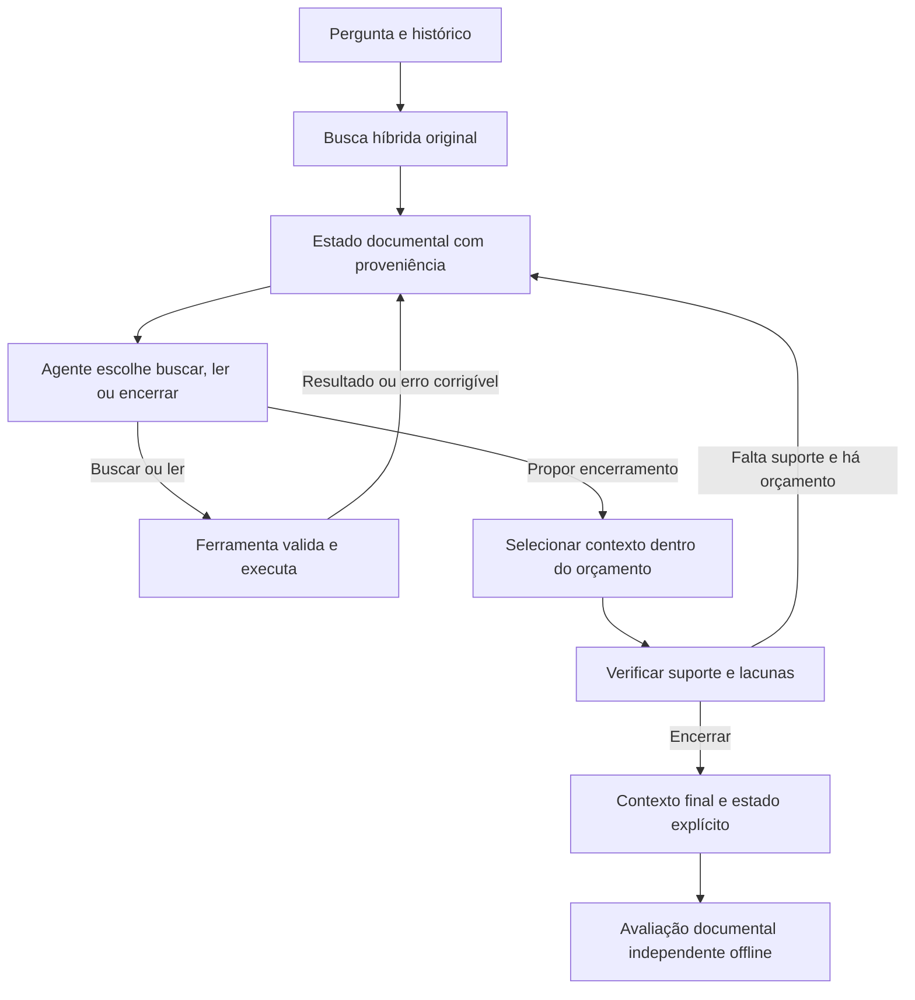

# Investigação da arquitetura do agente de retrieval

15/10/2026 · Auditoria dos resultados salvos e pesquisa bibliográfica · Propostas ainda não implementadas.

**Conclusão:** há evidência concreta de fragilidade na interface e no controle do ciclo. O sistema interrompe investigações por problemas corrigíveis, mistura escolha de documento com comprovação de fatos e permite que uma declaração de suficiência seja aceita sem comprovação semântica. Isso justifica priorizar a arquitetura. Não demonstra que toda falha seja arquitetural nem que a capacidade do modelo seja irrelevante.

Esta investigação não executou inferência, não modificou a configuração congelada e não alterou resultados históricos. A base empírica principal é `reason_validation_qwen36_spark_2026-10-14/run_01`, confrontada com o código e com as requisições/respostas salvas. A auditoria complementar está em [JSON](./auditoria_arquitetura_agente_2026-10-15.json), com hashes das fontes.

## 1. O que os resultados realmente permitem concluir

São as mesmas **70 perguntas**, executadas na coleção e, separadamente, com os documentos corretos fornecidos como controle diagnóstico. Nenhuma resposta final foi gerada.

| Nas 70 perguntas da coleção | Busca original | Agente estrito | Agente tolerante |
|---|---:|---:|---:|
| Contexto com evidência completa | 51 | 51 | 51 |
| Execução sem erro operacional | 70 | 25 | 43 |
| Evidência completa e execução sem erro | 51 | 22 | 37 |

A tolerância à justificativa reduziu interrupções, mas não mudou nenhum acerto de evidência final em relação ao agente estrito. Essa é uma melhoria operacional comprovada, não uma melhoria comprovada de retrieval.

Nas 27 execuções com erro do agente tolerante na coleção, 14 ainda conservaram contexto documental completo. Portanto, não é correto interpretar os 27 erros como 27 respostas factualmente erradas. Também não é correto interpretar uma execução sem erro como julgamento correto.

O controle com documentos corretos alcança 60/70 completas com o agente, contra 58/70 na busca original. Esses dois ganhos já existiam antes da tolerância. Eles não demonstram que o agente sabe encontrar os documentos certos na coleção.

**Não houve falha de transporte, estouro observado de entrada ou esgotamento de saída nas novas chamadas desta rodada.** Isso enfraquece a hipótese de que o servidor ou o tamanho da janela expliquem estas interrupções. Não elimina possíveis efeitos de modelo, quantização, amostragem ou qualidade das observações; eles não foram isolados aqui.

## 2. As falhas operacionais se concentram em quatro grupos

| Causa terminal registrada | Coleção: 70 perguntas | Documentos corretos: mesmas 70 |
|---|---:|---:|
| Referência de origem do filtro documental inválida | 19 | 6 |
| Busca considerada repetida | 2 | 6 |
| Citação para justificar filtro acima de 300 caracteres | 5 | 0 |
| JSON malformado | 1 | 0 |
| Total | 27 | 12 |

As duas colunas representam execuções distintas das mesmas perguntas. As 39 ocorrências não representam 39 perguntas distintas. Erros operacionais, evidência faltante e julgamento incorreto são eixos diferentes e podem coexistir.

### 2.1 O agente confunde o documento com o trecho que justifica o documento

Hoje uma busca pode exigir `document_id`, `scope_source` e `scope_quote`. O agente vê IDs de documentos, parents e children. Para filtrar pelo documento, precisa preencher corretamente uma referência de outro tipo e copiar uma citação.

**Achado:** nas 25 falhas de `scope_source`, a resposta usou um ID de documento conhecido nesse campo. Em 24, era exatamente o documento solicitado para a busca. Não eram 25 documentos inventados. Em 13, a citação também aparecia literalmente em texto visível do documento solicitado; em 12, havia uma única correspondência visível.

**Mecanismo:** `canonical_decision` aceita nesse campo `question`, parent visível ou child visível. Um ID documental provoca exceção antes da análise posterior do filtro. O controlador encerra o caso.

**Interpretação:** temos um erro real de preenchimento do modelo, amplificado por uma interface que exige redundância e torna esse erro fatal. A coincidência literal não comprova a pertinência do filtro e não permite declarar que 13 perguntas seriam recuperadas.

**Melhoria proposta:** expor `search(query, document_id?)`. O documento deve existir e pertencer ao escopo autorizado. A escolha pode estar semanticamente errada, mas deve ser observada como estratégia de busca, não como afirmação documental comprovada. A ferramenta retorna documento, IDs e proveniência; o modelo não precisa reconstruir essa proveniência para simplesmente consultar um documento permitido.

Se precisarmos justificar a escolha para análise, registrar uma referência opcional ou explicação breve, sem transformá-la em prova factual. Manter validação estrita de autorização e existência. Nunca aceitar IDs inventados ou ultrapassar o escopo permitido.

### 2.2 O controlador transforma refinamento em repetição

**Achado:** nas oito ocorrências de `RepeatedQuery`, o modelo solicitou um documento específico, mas omitiu a prova do filtro. O código abriu o escopo novamente e identificou a consulta efetiva como já executada.

Exemplo real, C01 na coleção:

1. Já havia sido feita uma busca aberta por “coordenador projeto AFO”.
2. O modelo pediu o mesmo texto, agora no documento AFO.
3. A prova documental exigida estava ausente.
4. O controlador retirou o filtro.
5. A consulta voltou a ser a busca aberta anterior e o caso terminou por repetição.

**Melhoria proposta:** a ferramenta precisa executar a intenção validada ou devolver um resultado explícito explicando por que não a executou. Não converter a intenção para outra busca sem que o agente observe a mudança. Uma busca repetida pode devolver o identificador do resultado anterior e permitir uma decisão diferente, consumindo o orçamento de decisão, mas sem executar retrieval duplicado.

### 2.3 Erros corrigíveis encerram todo o ciclo

`InvestigationController.run` interrompe a execução sempre que a decisão tem status diferente de `ok`. O agente recebe resultados de buscas, mas não recebe a oportunidade de reagir ao erro de uso da ferramenta.

**Melhoria proposta:** distinguir resultado recuperável de falha fatal. Referência inválida, consulta já feita e argumento ausente podem retornar feedback conciso: ação não executada, campo problemático, valores válidos e orçamento restante. O modelo decide novamente dentro de um limite explícito.

Isso é uma nova intervenção, não uma reparação invisível dos resultados anteriores. Cada decisão de correção conta como chamada. Uma chamada de transporte com resultado desconhecido permanece bloqueada para repetição automática. Corrigir o uso de uma ferramenta e repetir uma geração desconhecida são situações diferentes.

## 3. Há fragilidade semântica além dos problemas de interface

### 3.1 Aceitação técnica não é suficiência documental

No contrato mínimo, `finish_sufficient` é uma declaração do modelo. A validação local verifica forma, ação, consultas e escopo; não verifica se os documentos demonstram a relação pedida.

Na coleção, houve 43 declarações aceitas: 37 com contexto completo, cinco incompletas sem pendência de alinhamento e uma incompleta com pendência documental. Os cinco casos são C02, H03, S01, Q01 e Q10. C09 deve permanecer separado por sua pendência de alinhamento. Esses números não são uma medida de precisão em perguntas inéditas.

**Caso H03:** o próprio texto produzido admite faltar confirmação explícita da coordenação do SAAR e termina dizendo que pretende buscar essa confirmação. Entretanto, a ação retornada é `finish_sufficient` e a lista de consultas está vazia. O controlador segue a ação.

Isso é uma inconsistência real do modelo. A arquitetura atual não a detecta semanticamente. Não podemos prometer eliminá-la apenas com um schema melhor, com temperatura zero ou com mais tokens.

**Melhoria proposta:** testar um verificador de encerramento com responsabilidade estreita: receber pergunta, histórico e o contexto final exato; identificar pedidos ou ligações ainda sem suporte e apontar suas fontes. Ele não recebe o gabarito, a categoria nem a justificativa persuasiva do planejador. Sua avaliação continua sendo uma estimativa falível, comparada offline ao `evidence_v2`.

Começar com uma verificação quando o agente propuser encerrar, sem um comitê permanente de agentes. Uma eventual objeção retorna como observação, dentro de um limite de chamadas previamente congelado. Não restaurar automaticamente todo o contrato completo de necessidades, grafos e citações a cada decisão.

### 3.2 A memória de investigação é menor do que parece

No contrato mínimo, o código remove o `ledger`. A observação seguinte mantém as buscas anteriores e os textos atualmente selecionados/amostrados; não mantém explicitamente as lacunas, hipóteses e vínculos de evidência da decisão anterior. A próxima decisão é uma reconstrução com informação parcial.

**Fato confirmado:** esse estado não é transmitido. **Hipótese ainda não isolada:** isso contribui para esquecer ligações descobertas ou voltar a consultas anteriores.

**Melhoria proposta:** testar memória externa pequena, com referências aos trechos observados, a pergunta que cada busca tentou esclarecer e lacunas ainda abertas. Dados de ferramentas e proveniência ficam sob responsabilidade do código. Interpretações produzidas pelo LLM ficam identificadas como hipóteses, sem se tornarem evidência documental. Não reenviar raciocínio privado nem exigir reconstrução integral dessa memória em toda chamada.

## 4. O agente busca, mas tem pouco controle sobre o que consegue examinar e entregar

Atualmente ele recebe o contexto selecionado e até seis children adicionais, no máximo dois por documento. Pode pedir outra busca ou encerrar. Não possui uma ação própria para abrir integralmente um trecho encontrado ou examinar seu vizinho.

Após cada busca, a união é reranqueada contra a pergunta original. Os parents entram por ordem global enquanto couberem em 3.000 tokens. Esse seletor não usa explicitamente as ligações intermediárias identificadas pelo agente.

**Achados:** na coleção, C02, C08, H04 e L05 têm evidência completa na união, mas contexto final incompleto. No controle documental, ocorre em C01, C02, H04 e H06. Em H04, a investigação tolerante encontra a evidência AFO_NAME nos candidatos, mas ela não chega ao contexto final. São problemas de entrega/seleção, não ausência dessa evidência nos candidatos.

**Limite:** não foi calculado nesta auditoria se o conjunto mínimo de parents inteiros cabe em 3.000 tokens em cada um desses casos. Antes de culpar apenas o ranking, separar viabilidade de seleção e impossibilidade por orçamento.

**Melhorias propostas, em experimentos separados:**

- `read(result_id)`: permitir examinar um parent já encontrado, com proveniência automática e orçamento próprio de leitura. É uma mudança de observação; não exige trocar embeddings nem reindexar de início.
- Seleção consciente das necessidades: preservar conjuntos de evidências que demonstram uma ligação, em vez de depender apenas da relevância individual para a pergunta original. Testar primeiro por replay dos candidatos existentes, com parents inteiros e o mesmo limite final.
- Manter todos os trechos encontrados em memória externa; diferenciar “recuperado”, “mostrado ao agente” e “incluído no contexto final”. Guardar todos externamente não significa enviar todos ao LLM.

O agente pode passar a ler melhor sem que o contexto final melhore. Por isso observação e seleção precisam ser medidas separadamente.

## 5. A arquitetura proposta deve tornar o caminho legível

Esse é o destino proposto, não um fluxo já implementado. Primeiro, corrigir a comunicação; depois testar leitura, memória, seleção e verificação uma a uma. Um único agente com ferramentas claras pode ser suficiente. Não há evidência local que justifique começar adicionando vários agentes ou trocando de framework.

**Manter:** proveniência, textos originais, escopos autorizados, caches assinados, preservação do último contexto, registro de custos e isolamento do gabarito. Essas proteções têm valor. A fragilidade está em tratar validade de protocolo como garantia semântica e falhas de uso como encerramentos irreversíveis.

Para acompanhar cada pergunta, a interface deve mostrar uma linha por etapa:

| Etapa | O que queria descobrir | Ação solicitada e efetiva | O que encontrou/observou | O que entrou/saiu do contexto | Por que continuou/parou |
|---|---|---|---|---|---|
| Exemplo ilustrativo | Identidade necessária para uma ligação | Buscar em documento conhecido | Trecho e fonte | Parent selecionado ou descartado, com motivo | Lacuna permanece ou orçamento terminou |

Cada evento guarda `stage`, `code`, `recoverable`, `action_executed`, `context_preserved`, referência à evidência e duração. Não reduzir tudo a `status=error`. A mensagem humana traduz o código, mantendo o detalhe técnico expansível.

A página principal deve responder, nessa ordem: **encontrou a evidência? conseguiu entregá-la no contexto? julgou corretamente o encerramento? houve incidente operacional? quanto custou?** “Completa e sem erro” pode continuar como medida secundária. Fim por orçamento é uma parada controlada; não deve ser confundido com indisponibilidade da API. Uma correção bem-sucedida conserva o incidente no histórico, sem transformar toda a execução em falha terminal.

## 6. O que a literatura recente acrescenta

Pesquisa consultada em 15/10/2026. As recomendações abaixo são inferências para o nosso sistema, não reprodução dos resultados publicados. Estudos sobre respostas finais, web aberta, outros modelos ou treinamento não são diretamente comparáveis ao nosso benchmark de contexto documental.

| Fonte primária | Contribuição pertinente | Como usar aqui e qual a ressalva |
|---|---|---|
| [A-RAG, fevereiro de 2026](https://arxiv.org/html/2602.03442v1) | Interface hierárquica: busca lexical, busca semântica e leitura de chunks em um ciclo simples. | Inspira separar localizar de ler, começando com nosso híbrido existente e uma ação de leitura. Não exige copiar o índice nem trocar o retrieval. A ablação da leitura tem efeitos pequenos e mistos em algumas métricas; o artigo não garante que apenas adicionar `read` resolverá nosso caso. |
| [PAR²-RAG, março de 2026](https://arxiv.org/abs/2603.29085) | Separa exploração inicial ampla de refinamento guiado por suficiência; discute comprometimento prematuro com uma trajetória. | Inspira manter hipóteses documentais abertas e investigar lacunas. Não justifica aumentar indiscriminadamente o número de buscas. Evidência de arXiv; precisamos de teste local. |
| [VikingRAG, setembro de 2026](https://arxiv.org/abs/2609.11390) | Integra acesso semântico e estrutural; usa lacunas de evidência e escalonamento adaptativo de uma para várias rodadas. | Inspira leitura estrutural e acionar investigação quando necessário. Reuso de trajetórias é outra intervenção e poderia contaminar a comparação; deixá-lo fora da primeira rodada. Preprint recente. |
| [Predicting Partial Answer Quality and Utility in Agentic RAG, setembro de 2026](https://arxiv.org/abs/2609.16453) | Analisa qualidade e utilidade por iteração, em vez de olhar somente o fim; informa aceite no CIKM 2026. | Inspira medir evidências ganhas/perdidas a cada etapa. O trabalho usa respostas intermediárias; aqui usaríamos contexto documental, mantendo a geração final bloqueada. Não importamos seus ganhos numéricos. |
| [Agentic-R, janeiro de 2026](https://arxiv.org/abs/2601.11888) | Investiga treinamento de retrievers para utilidade em buscas agênticas, além de similaridade local. | Reforça a hipótese de que ranking relevante para uma pergunta isolada pode perder ligações úteis ao percurso. Treinamento fica para depois da correção da interface e do diagnóstico de seleção. |
| [Sufficient Context, ICLR 2025](https://research.google/pubs/sufficient-context-a-new-lens-on-retrieval-augmented-generation-systems/) | Distingue contexto suficiente de capacidade do modelo de utilizá-lo e abster-se quando necessário. | Sustenta separar cobertura documental, declaração do agente e correção factual. Nosso `evidence_v2` permanece independente; um novo verificador LLM não vira gabarito. |
| [Writing effective tools for agents, Anthropic, setembro de 2025](https://www.anthropic.com/engineering/writing-tools-for-agents) | Recomenda ferramentas claras, retornos úteis, inspeção de transcrições e avaliação de erros de uso. | É orientação de engenharia, não ensaio causal sobre Qwen. Dá suporte ao teste de uma API simples, ao feedback corretivo e à inspeção das ações efetivas, sem regras por projeto. |
| [Search-R1, 2025](https://arxiv.org/abs/2503.09516) | Treina interação entre raciocínio e busca por reforço. | Contraponto à hipótese de que capacidade do modelo nunca importa: usar busca bem também é uma habilidade aprendida. Não precisamos começar treinando; tampouco podemos excluir limitações do modelo sem teste. |

## 7. Ordem de investigação recomendada

| Ordem | Intervenção isolada | Motivação local | Evidência de sucesso a procurar |
|---|---|---|---|
| 0 | Relato por etapa e taxonomia estável | Erros e qualidade estão sendo confundidos | Uma pergunta pode ser compreendida sem abrir vários arquivos; classificação reproduzível a partir dos eventos |
| 1 | Simplificar filtro documental para ID conhecido e autorizado | 25 falhas de tipo de referência; oito refinamentos convertidos em repetição | Ações pretendidas executáveis, sem vazamento de escopo; depois medir evidência, não somente aceitação |
| 2 | Devolver erros corrigíveis ao ciclo | A primeira falha de protocolo encerra a investigação | Correções dentro do mesmo limite de decisões, sem chamadas ocultas nem mais loops improdutivos |
| 3 | Testar seleção e viabilidade sobre candidatos salvos | Quatro contextos incompletos com união completa na coleção | Evidência adicional no mesmo orçamento, separando casos inviáveis de escolhas ruins |
| 4 | Testar leitura sob demanda e, separadamente, memória curta | Observações limitadas; ausência de ledger no contrato mínimo | Descoberta observável orienta a próxima ação e permanece disponível, sem acrescentar texto gerado às evidências |
| 5 | Verificação de encerramento | Cinco falsas suficiências confirmadas na coleção, além da pendência C09 | Menos encerramentos incorretos, sem aumentar rejeições de contextos completos e com custo registrado |

A ordem pode ser ajustada pelo custo de implementação, mas não combinar as mudanças em um único braço e depois atribuir o ganho a uma delas. As etapas 1 e 2 são a prioridade imediata da infraestrutura; a etapa 3 pode começar por análise offline, sem geração.

Congelar Qwen3.6, reasoning desligado, temperatura 0, seed 42, saída 4.096, janela local 16.384, contexto final 3.000 e os demais parâmetros já aprovados. Congelar também prompts e contratos **por variante**: eles necessariamente mudarão quando a intervenção for a interface. Uma mudança de prompt não deve passar por mudança de modelo.

Começar com respostas salvas e casos sintéticos genéricos para validar o comportamento do controlador; isso não mede ganhos de retrieval. A comparação de qualidade deve continuar nas mesmas 70 perguntas, com resultados da coleção separados do controle documental. O modelo não recebe IDs de benchmark, gabaritos ou categorias. Não alegar transferência para novos domínios.

No primeiro teste de feedback, manter quatro buscas e quatro decisões totais: uma correção consome uma decisão. Para leitura e verificação, definir previamente quantas chamadas/tokens adicionais serão permitidos e usar controles de custo; não esconder novas chamadas sob o mesmo rótulo de orçamento.

Avaliar incidentes recuperados e terminais, completude, cobertura parcial, perdas de evidência, falsas suficiências, paradas prematuras e custo físico. Uma execução que aceita mais JSONs, mas continua nas mesmas 51 perguntas completas, não demonstrou melhoria de retrieval.

## 8. Rastreabilidade local

- [Relatório da rodada tolerante](../benchmark/results/rounds/reason_validation_qwen36_spark_2026-10-14/run_01/report.md).
- [Resultados por pergunta](../benchmark/results/rounds/reason_validation_qwen36_spark_2026-10-14/run_01/C_tolerant/retrieval.json).
- [Requisições e respostas salvas](../benchmark/results/rounds/reason_validation_qwen36_spark_2026-10-14/run_01/cache.json).
- [Comparações e auditoria documental](../benchmark/results/rounds/reason_validation_qwen36_spark_2026-10-14/run_01/comparison.json).
- [AdaptiveRetrieval.py](../application/service/rag/v2/AdaptiveRetrieval.py): `canonical_decision` linha 74; preparo de observação linha 191; remoção do ledger linha 228; validação do filtro linha 323; controlador linha 369 e parada por erro linha 386.
- [DirectedRetrieval.py](../application/service/rag/v2/DirectedRetrieval.py): união e reranking global, linha 149.
- [EvidenceSelection.py](../application/service/rag/v2/EvidenceSelection.py): formação de parents linha 132 e empacotamento por orçamento linha 165.

**Recomendação:** revisar a interface e o controle antes de trocar modelo ou aumentar orçamento. A arquitetura inteira continua sem aprovação. A investigação sustenta mudanças específicas e verificáveis; não sustenta atribuir todos os erros ao servidor, nem prometer que um modelo forte funcionará corretamente após apenas uma alteração de contrato.
